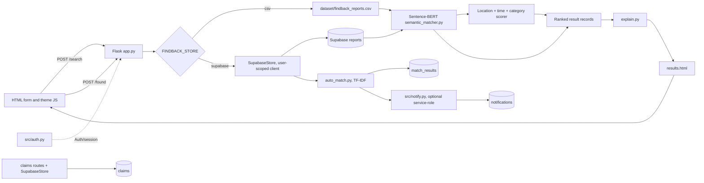

# FindBack project architecture

This document describes the integration branch as inspected on 2026-10-25. It
distinguishes the verified local CSV demo from Supabase code that has only been
tested with fakes. No production database or credentials were used.

## At a glance

FindBack accepts a lost-item description and context, compares it with Found
reports, ranks candidates, and displays the details that contributed to each
score. In local mode, Flask reads a synthetic CSV and does not persist the lost
search. Found submissions append to the CSV. Supabase mode has owner-bound
report storage and Auth code, but it is not currently a user-facing workflow:
credential forms are intentionally absent and database behavior has not been
verified against PostgreSQL.

## Architecture diagram



The diagram shows implemented paths. The Supabase edges are not live-verified.

## Request flow: local CSV search

1. `templates/index.html` posts the named fields to `/search`; the form includes
   a CSRF token and a per-render submission key.
2. `app.search()` rejects an invalid storage mode, validates required fields,
   trims user input, and checks for a description accidentally placed in the
   location field.
3. In CSV mode, the Lost report is a temporary Python dictionary. It is not
   written to disk. `find_semantic_matches_for_report()` calls `load_dataset()`.
4. `src/semantic_matcher.py` loads the report CSV and lazily loads
   `sentence-transformers/all-MiniLM-L6-v2` when the first real match is
   requested. It encodes descriptions and caches normalized dataset embeddings
   until the CSV modification time changes.
5. The query embedding is compared with cached report embeddings by cosine
   similarity. Rows whose `report_type` is Found are scored and sorted by
   `final_score`, descending; the default result limit is five.
6. `src/matcher.py` supplies context helpers. `src/explain.py` turns the actual
   component scores and differing fields into supporting/conflicting notes.
   `templates/results.html` renders those details and explicitly says a score
   is not proof of ownership.

### Score used by primary search

```text
final = 0.50 × description + 0.25 × location
      + 0.15 × time        + 0.10 × category
```

- **Description:** Sentence-BERT embeddings followed by cosine similarity.
- **Location:** weighted overlap across place (0.30), campus/branch (0.15),
  building (0.20), floor (0.10), and specific area (0.25). Missing values on
  either side are skipped. Exact equality contributes full field weight;
  containment contributes 90%; SequenceMatcher ratios of at least .80 or .60
  contribute 75% or 50% respectively.
- **Time:** missing or malformed values score zero. Absolute separation scores
  1.0 up to 30 minutes; .8 up to 60; .5 up to 120; .25 up to 360; .1 up to
  1,440; then 0.
- **Category:** case-insensitive exact match scores 1; mismatch or missing data
  scores 0.

All components are heuristics with no calibration study. The weighted value is
a ranking similarity, not a probability that the item belongs to the searcher.
The optional `FINDBACK_MIN_SCORE` filter is applied after top-five truncation,
so it does not search deeper to replace removed candidates.

## Found report flow

`GET /found` renders the form. `POST /found` validates the same category,
description, place, date, and time fields. In CSV mode it assigns `FB###` and
appends a row through `save_found_report()` in `app.py`. The next search reloads
embeddings if the CSV mtime changed. No automatic matching or notification is
run in CSV mode. CSV found submission is append-only and lacks a durable
idempotency key; the checked-in dataset must not be used for test submissions.

## Supabase code path

`FINDBACK_STORE=supabase` is checked in `app.py`; missing Supabase config returns
a safe error instead of falling back to CSV. `src/auth.py` creates Supabase Auth
sessions and stores access/refresh tokens in process memory, while the signed
cookie carries an opaque session id and display metadata. `SupabaseStore` uses
the logged-in user's client for ordinary CRUD, applying RLS.

- A lost search saves a Lost report with the current owner and submission key,
  reads active Found rows, and passes those rows to the same semantic scoring
  implementation. The pair is then upserted.
- A found submission stores an owner-bound Found report with a key and invokes
  `src/auto_match.py` against active Lost rows. This automatic path uses TF-IDF
  description similarity plus context, not Sentence-BERT. Its location helper
  is simpler than primary search: exact/containment match only.
- `src/notify.py` uses the service-role client only when configured. It derives
  the recipient from the Lost report owner, rereads both reports, checks types
  and active status, constructs the message on the server, and deduplicates.
- Claim routes require a logged-in session and check report type/owner in Python;
  store methods and intended RLS add database-side checks.

The app's public credential forms have been removed. `/login` and `/register`
GET requests render an explanatory page, not a form. Tests monkeypatch Auth and
Supabase clients; they do not prove real Auth, token refresh, RLS, constraints,
notifications, or migrations work against a project. Migration 004 is prepared
but unapplied.

### Current SQL privacy concern

Both `db/schema.sql` and `db/migrations/004_core_dataflow_security.sql` define a
report SELECT policy equivalent to `status = 'active' OR owner_id = auth.uid()`
for anonymous and authenticated roles. Because the condition does not check
`report_type`, every active Lost report is exposed through the database API to
anonymous callers, not just Found reports intended for search. The authenticated
global auto-matcher also currently reads active Lost rows using a user client,
so tightening this policy safely requires moving that cross-owner read/match
work behind a trusted backend path and testing it on an isolated Supabase
project. Do not apply an ad hoc policy change or migration 004 to production.

Profiles are self-readable and match rows are participant-readable in the
prepared SQL. Claims are scoped to claimant/report owner and status transitions;
notifications are recipient-scoped and use a server-side service-role writer.
These are code-review conclusions, not executed RLS results.

## Key technologies and files

| File | Role |
|---|---|
| `app.py` | Flask app, request validation, routing, CSV behavior, orchestration of Supabase paths. |
| `wsgi.py`, `Procfile` | Production WSGI import and one-worker Gunicorn command. |
| `templates/base.html`, `templates/index.html`, `templates/found.html`, `templates/results.html` | Jinja-rendered UI and HTML form contracts. |
| `static/style.css`, `static/theme.js` | Responsive style tokens, light/dark palette, persisted system-aware theme. |
| `src/semantic_matcher.py` | Lazy Sentence-BERT model, CSV embeddings cache, primary ranked match output. |
| `src/matcher.py` | TF-IDF/context baseline and location/time/category scoring helpers. |
| `src/auto_match.py` | Supabase Found-to-Lost automatic match flow using TF-IDF/context. |
| `src/explain.py` | Deterministic score contribution and attribute evidence construction. |
| `src/preprocess.py` | Lowercase/punctuation/whitespace cleanup used by the TF-IDF baseline. |
| `src/store.py` | CSV/Supabase store classes; the Flask route code still branches directly and retains CSV helpers in `app.py`. |
| `src/auth.py`, `src/db_config.py` | Supabase Auth session helpers and environment-driven clients. |
| `src/notify.py` | Trusted server-side cross-user notification creation. |
| `db/schema.sql`, `db/migrations/002*`, `003*`, `004*` | Schema and reviewed migration drafts; none were applied in this pass. |
| `src/benchmark_evaluate.py`, `src/check_leakage.py` | Read-only evaluator and dev/test duplicate check. |
| `tests/` | Pytest route, scoring, session, store, notification, SQL-contract, and template checks. |

Flask receives browser form data and returns server-rendered HTML. The browser
does not call Supabase directly and contains no service-role key. Sentence
Transformers and scikit-learn run in Python. Pandas reads/writes the CSV and
prepares result frames. `python-dotenv` optionally loads a local `.env` (ignored
by Git); no `.env` values were inspected in this audit.

## Test and evaluation boundary

The suite uses Flask's test client, fake model/client boundaries, and temporary
files. It is strong evidence for local logic and contracts, not a substitute for
PostgreSQL/RLS integration or browser testing. The real offline smoke run here
loaded the cached Sentence-BERT model and used a disposable copy of the
synthetic dataset. The benchmark evaluator reported no evaluable rows; the
leakage checker reported no real rows to compare. No model-quality metric is
available.

## Known architecture trade-offs

- The primary CSV search scans candidate descriptions and context in Python;
  work grows roughly with the number of reports. Dataset vectors are cached in
  worker memory.
- Model loading is lazy, so app startup is fast but the first search has model
  initialization latency and memory cost.
- CSV storage is local-file based; a found-row append can race under concurrent
  requests, and CSV mode is inappropriate for multi-instance persistence.
- Auth token state is process-local and the deployment manifest uses one worker.
  Scaling to several workers needs a shared server-side session store.
- The app has two deliberate description methods: Sentence-BERT for primary
  search and TF-IDF for automatic Supabase matching. Quality equivalence has
  not been measured.
- There is no real labeled benchmark or calibration data, so threshold tuning
  and claims about recovery accuracy are unsupported.

## Final master-pass verification — 2026-10-25

The CSV-mode homepage and results template now include a visible note that the
checked-in report examples are synthetic. The note is suppressed when
`FINDBACK_STORE=supabase` is requested. CSS for the homepage hero background and
section divider is bounded to its section instead of using `100vw`, avoiding a
known viewport-width overflow pattern. Source-level tests cover that rule, but
no browser was available to confirm rendered overflow at device widths.

Current test evidence: baseline **156 passed**; final suite
`python -m pytest tests/ -q --basetemp=.pytest-master-final3` — **159 passed**;
theme/template subset — **19 passed**. Local HTTP checks on port 5187 returned
200 for the main public pages/assets; a valid sample search returned candidate
FB002 and the similarity disclaimer. These checks do not verify browser
rendering or external Supabase behavior. The three protected CSV hashes remain
unchanged (see `OVERNIGHT_COMPLETION_REPORT.md`).

## Deployment readiness addendum — 2026-10-25

`GET /healthz` is a lightweight liveness route returning only a generic status;
it performs no model load or database request. The WSGI import was verified
with `FLASK_DEBUG=0` and a throwaway local key. No Render deployment was
prepared: the connected Render workspace has no FindBack service, and neither
CSV mode nor the current Supabase/Auth/RLS path is safe for public use. See the
deployment pass in `OVERNIGHT_COMPLETION_REPORT.md`.
