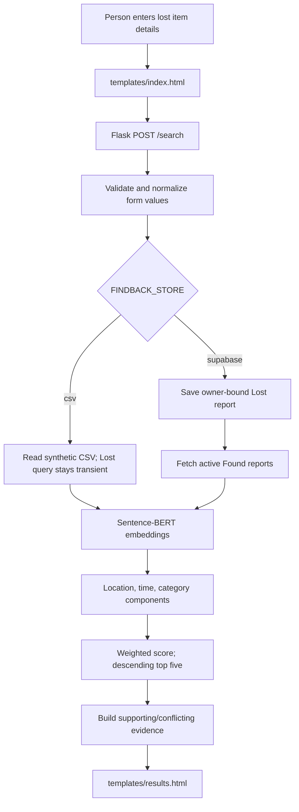

# FindBack viva preparation

This guide follows the code on `integration/production-readiness-ui`, audited on
2026-10-25. Practice saying “implemented but not externally verified” when that
is the true status. The checked-in report data are synthetic examples, not real
community reports.

## 1. A simple project explanation

FindBack is a lost-and-found search tool. A person describes an item they lost,
where they last saw it, and roughly when. The app compares that description and
context with Found reports and ranks likely candidates. It gives the person
evidence to review, but it cannot prove who owns an item.

The main local demonstration uses a CSV file and a Sentence-BERT model. The
current CSV search does not save the Lost search; it only compares it with
existing Found rows. A Found report can be appended to CSV, so it must not be
submitted while the app points to the protected checked-in sample file. The
repository also has Supabase Auth, report, claim, match, and notification code,
but that full workflow has not been verified against a database and the public
credential forms have intentionally been removed.

## 2. Technology-by-technology

| Technology | Why it is used here | Where / input / output | Alternative and trade-off |
|---|---|---|---|
| Python | Implements web routes, matching, storage, and evaluation. | `app.py`, `src/`; receives form dictionaries/CSV rows and returns rendered pages or scored records. | Another backend language could work, but would replace the existing code and NLP integration. |
| Flask | Small server-rendered web app with explicit routes. | `app.py`; HTTP form fields become validated Python values and Jinja pages. | A larger framework adds structure but is unnecessary for this app's current route count. |
| Jinja + HTML forms | Server-rendered UI and standard POST forms. | `templates/*.html`; sends named fields to Flask and displays escaped output. | A client-side SPA is unnecessary and would add a separate API/auth surface. |
| Pandas | Reads CSV rows and shapes candidate results. | `src/semantic_matcher.py`, `src/matcher.py`; DataFrames become rows/records. | Built-in `csv` is used for the append path; pandas is convenient for ranking tables. |
| Sentence-Transformers / Sentence-BERT | Encodes sentence meaning so related descriptions can score well without exact word overlap. | `src/semantic_matcher.py`; report descriptions become normalized vectors. | TF-IDF is cheaper/simpler and already used by the legacy/automatic matcher, but depends more on word overlap. |
| scikit-learn | Supplies cosine similarity, TF-IDF, and vectorizer utilities. | `src/semantic_matcher.py`, `src/matcher.py`, `src/auto_match.py`; vectors become similarity scores. | Other vector libraries exist, but current tests and algorithm already use scikit-learn. |
| CSV | Simple local demo storage. | `dataset/findback_reports.csv`; Found report rows append; Lost searches are transient. | PostgreSQL is better for concurrent durable records, ownership, constraints, and transactions. |
| Supabase PostgreSQL + Auth | Optional owner-bound persistent storage and identity. | `src/store.py`, `src/auth.py`, `src/db_config.py`, `db/`; SQL definitions are in `db/`. | A separately hosted PostgreSQL/Auth stack is possible, but the current app has Supabase-specific clients and SQL. This path is unverified. |
| Pytest | Regression checks for route, score, auth/session, storage, and SQL text contracts. | `tests/`; runs local logic with temporary files and fakes. | A live database and browser suite would add integration confidence but are not available in this environment. |

No frontend framework, Google OAuth, Gemini integration, or vector database is
implemented.

## 3. Architecture and primary flow



For CSV mode, `app.search()` calls
`semantic_matcher.find_semantic_matches_for_report()`. That function reloads
the CSV only when its modification time changes, lazily gets the model, and
compares the query to cached report embeddings. The result DataFrame is converted
to records, `explain_match()` adds evidence text, and `results.html` renders the
candidate cards.

For Found submissions, `POST /found` validates the same general report fields.
CSV mode assigns an `FB###` identifier and appends a row. Supabase mode saves an
owner-bound row with an idempotency key, then calls automatic matching. That
automatic Supabase path uses TF-IDF plus context; it is separate from the
Sentence-BERT primary search. Notifications are attempted by a trusted server
writer when its optional service-role credential exists.

## 4. Matching walkthrough

The main search score is:

```text
0.50 × description similarity
+ 0.25 × location similarity
+ 0.15 × time similarity
+ 0.10 × category similarity
```

Description similarity is cosine similarity between normalized
Sentence-BERT vectors. Location compares five fields with weights: place 30%,
campus 15%, building 20%, floor 10%, specific area 25%. If a field is missing
on either report, it is skipped rather than treated as a mismatch. Time gets
full credit up to 30 minutes apart, then falls through buckets (60, 120, 360,
and 1,440 minutes), after which it scores zero. Category is a case-insensitive
exact match. Candidates sort by final score descending and the app displays at
most five.

The user-facing explanation reports component scores and comparisons derived
from the actual two rows. It does not explain the model's internal neural
representation. No score calibration or real labeled quality study exists, so a
“72%” score means a weighted similarity value, not a 72% chance of ownership.

## 5. Important files and functions

| File | Key function / role | What to remember |
|---|---|---|
| `app.py` | `search()`, `found()` | HTTP validation and orchestration; CSV Lost searches are not stored. |
| `src/semantic_matcher.py` | `_get_model()`, `load_dataset()`, `find_semantic_matches_for_report()` | Lazy model and embeddings cache; primary Sentence-BERT path. |
| `src/matcher.py` | `find_matches()`, `calculate_*_similarity()` | TF-IDF/context matcher and helpers; also used by old analysis code. |
| `src/auto_match.py` | `process_new_found_report()` | Supabase Found-to-Lost matching and pair/notification orchestration. |
| `src/explain.py` | `explain_match()` | Builds evidence from scored fields; does not add a score. |
| `src/store.py` | `CsvStore`, `SupabaseStore` | Storage implementations. The Flask routes still branch directly in places rather than routing all calls through `get_store()`. |
| `src/auth.py` | `sign_up()`, `sign_in()`, `get_user_client()`, `login_required()` | Supabase email/password and process-local token/session handling; no public credential form now. |
| `src/notify.py` | `notify_match_owner()` | Server derives recipient and rereads report ownership/status before service-role insert. |
| `db/schema.sql` | table, grant, RLS definitions | Prepared schema only; not an executed database. |
| `db/migrations/004_core_dataflow_security.sql` | restrictive migration draft | Not applied; needs isolated PostgreSQL/Supabase validation. |
| `src/benchmark_evaluate.py` | `main()` / `evaluate_method()` | Read-only evaluator; current benchmark placeholders mean no metrics. |
| `src/artifact_paths.py` | `output_path()` | Sends generated scripts to ignored `outputs/`, away from protected CSVs. |

## 6. Likely viva questions and answers

### Basic

1. **What problem does FindBack solve?**<br>
   It helps compare a person's Lost-item description with Found reports so the person can inspect the closest candidates.

2. **Who uses the system?**<br>
   A person searching for an item and, in the broader intended workflow, a person submitting a Found report. The local demo has no real public users.

3. **What does the user enter?**<br>
   Category, description, last known place details, date, and approximate time.

4. **What does the system return?**<br>
   A ranked list of Found-report candidates with component scores and field-level evidence.

5. **Why is this useful compared with a keyword search?**<br>
   Sentence embeddings can score descriptions with related wording even when they do not share every exact word; place, time, and category also contribute.

6. **What is the main backend framework?**<br>
   Flask. It receives the form POST, validates data, calls the matcher/storage path, and renders Jinja templates.

7. **What is Jinja doing?**<br>
   It renders HTML on the server using route data, such as the lost search and candidate records. Jinja autoescaping helps keep untrusted text as text.

8. **Where is the app entry point?**<br>
   `app.py` is the development entry point. `wsgi.py` exports the Flask object for Gunicorn.

9. **What is the main local storage?**<br>
   `dataset/findback_reports.csv`. The file contains synthetic example records.

10. **Does local search save the Lost report?**<br>
    No. In CSV mode it is an in-memory dictionary used for that search only. Found submissions append to CSV.

11. **Are the reports in the demo real?**<br>
    No. The checked-in reports are synthetic examples. They must not be described as reports from real people.

12. **What is the most important limitation?**<br>
    There is no real, verified labeled benchmark, so we cannot claim real-world matching accuracy.

### Intermediate

13. **What is Sentence-BERT?**<br>
    It is a sentence-embedding model that maps text to a numeric vector. FindBack uses `all-MiniLM-L6-v2` to represent report descriptions.

14. **What does cosine similarity measure here?**<br>
    It compares the angle between two description vectors. In this use, closer direction means higher semantic similarity; it is not a calibrated probability.

15. **Why normalize embeddings?**<br>
    The model encodes normalized vectors so comparison is consistent and cosine similarity is straightforward.

16. **What is TF-IDF?**<br>
    A term-weighting representation that emphasizes words distinctive to a document. The legacy matcher and Supabase automatic match path use it instead of Sentence-BERT.

17. **Why keep a TF-IDF matcher?**<br>
    It is a simpler baseline and can run without loading the Sentence-BERT model. The project has not measured which method is better on real cases.

18. **What are the four score weights?**<br>
    Description 50%, location 25%, time 15%, and category 10%.

19. **Why are those weights used?**<br>
    They are the existing application weights, totaling 100%. They have not been tuned using a real labeled benchmark.

20. **How does location scoring work?**<br>
    It compares organization, campus, building, floor, and area with internal field weights. Missing fields are skipped. Exact, contained, and similar values receive different credit.

21. **How does time scoring work?**<br>
    It uses absolute time difference buckets from full credit within 30 minutes to zero beyond a day. Missing or malformed date/time scores zero.

22. **How does category scoring work?**<br>
    A case-insensitive exact category match gets 1; a mismatch or missing value gets 0.

23. **Why is the displayed score not a probability?**<br>
    It is a hand-weighted sum of similarity signals and has not been calibrated against outcomes. A percentage format does not make it a probability.

24. **How are candidates ordered?**<br>
    Descending by final score, limited to five by default.

25. **What does the explanation panel explain?**<br>
    It describes the actual component values and matching/conflicting report fields. It is a deterministic summary, not an explanation of neural attention.

26. **When does the Sentence-BERT model load?**<br>
    Lazily, on the first search that needs matching. This keeps application startup fast but makes the first search slower.

27. **How are CSV embeddings reused?**<br>
    Dataset descriptions are encoded and retained in process memory until the CSV modification time changes.

28. **What changes when Supabase mode is selected?**<br>
    The route code saves an owner-bound Lost or Found row and reads active reports using an authenticated Supabase client. This path is tested with mocks only.

29. **Does the browser talk directly to Supabase?**<br>
    No. The browser submits forms to Flask. Supabase calls and any service-role usage are server-side.

30. **How are claims protected?**<br>
    The Flask routes require a logged-in session and check the report owner. The prepared SQL also scopes claim reads and updates. Real RLS execution has not been tested.

31. **How are notifications protected?**<br>
    The server derives the recipient from the Lost report owner, rereads active reports, constructs the message, and uses a service-role client if configured. The real service has not been tested.

32. **How does CSRF protection work?**<br>
    The app creates a random token in the session and checks state-changing requests against the posted token. The check is bypassed only in Flask testing mode.

33. **Where are Auth tokens stored?**<br>
    In process memory keyed by an opaque session identifier. The signed browser cookie carries the handle and basic display metadata, not the access/refresh tokens.

34. **What is the limitation of process-local Auth state?**<br>
    It is lost on restart and does not work across multiple workers/instances without a shared session store. The current Procfile uses one worker.

35. **What do the tests verify?**<br>
    Local route contracts, scoring helpers, state/session behavior, fake Supabase interactions, migration text, and artifact paths. They do not verify live database policy execution.

### Advanced

36. **What can cause a false positive?**<br>
    Common descriptions, same-category items, incomplete context, or high text similarity between different objects can rank the wrong report highly.

37. **What can cause a false negative?**<br>
    A vague or very different description, incorrect date/place, missing report, language mismatch, or the correct candidate falling below top five.

38. **What is dataset bias here?**<br>
    The synthetic examples are developer-authored and narrow. They do not represent real language, venues, reporting behavior, or population diversity.

39. **What evaluation leakage risk exists?**<br>
    If development and held-out pairs describe the same event or copied text, test metrics are inflated. The repository includes a leakage checker, but the current files contain no real examples to compare.

40. **What did the current benchmark run show?**<br>
    It reported no evaluable rows because only EXAMPLE placeholders exist. Therefore, it generated no performance metrics.

41. **Does the main matcher use an approximate-nearest-neighbor index?**<br>
    No. It compares the query with the cached set of report embeddings in Python. Larger datasets will increase latency and memory.

42. **What would you improve for scale?**<br>
    Measure first, then consider database-side filtering, a vector index, background matching, and a shared session store. These are future work, not current features.

43. **What is the most important RLS concern found?**<br>
    The prepared active-report policy does not restrict `report_type`. Because it permits public access to all active reports, active Lost report descriptions and places are exposed to anon/authenticated database API users.

44. **Why not simply make Lost rows private in SQL now?**<br>
    The current Supabase auto-matcher reads active Lost rows through a user-scoped client. A safe fix needs a trusted server-side matching read, a reviewed policy design, and isolated database tests. A quick policy edit could break matching or give a privileged path too much access.

45. **Has migration 004 been applied?**<br>
    No. It is a draft. It needs review and an isolated Supabase/PostgreSQL test before any production discussion.

46. **Why is the public login page gone if Auth code exists?**<br>
    The UI-removal requirement explicitly removes public authentication controls. The backend code remains, but without a credential form the Supabase flow is not a usable public browser journey.

47. **Is Google login available?**<br>
    No. There is no Google OAuth route, callback, or provider implementation.

48. **What is the data exposure of current CSV mode?**<br>
    CSV mode is an anonymous local demo and has no per-user ownership. It should not be treated as a secure multi-user production store.

49. **What did you change to protect the datasets?**<br>
    The old evaluation/comparison scripts and hard-case generator now write to ignored `outputs/` paths rather than overwriting the tracked CSVs. Regression tests check those paths.

50. **What is still needed before production?**<br>
    Resolve Lost-report privacy and trusted matching, execute/test RLS in an isolated project, restore a supported Auth UI if needed, verify Supabase end-to-end, review deployment/session configuration, and assess matching with real labeled data.

## 7. Likely professor follow-ups

- **“You show 80%, so does that mean there is an 80% chance it is mine?”**<br>
  No. It is an uncalibrated weighted similarity score used to order candidates. Only a person and the venue can verify ownership.
- **“Why use Sentence-BERT and TF-IDF both?”**<br>
  The existing primary search uses Sentence-BERT; the automatic Supabase matcher retains a TF-IDF baseline. Their relative quality has not been measured on a valid benchmark.
- **“Can the demo claim a successful recovery?”**<br>
  No. The reports are synthetic and no real recovery event was verified.
- **“Did you test Supabase?”**<br>
  Only code paths with mocked clients and static SQL assertions. No isolated or production database was used in this run.
- **“Why is the account page not a login form?”**<br>
  The public UI removal requirement removed login/registration controls. Auth handlers remain, but they are not exposed as a complete browser flow.
- **“What would you fix first?”**<br>
  Restrict active Lost-report exposure while moving global matching behind a trusted server path, then test that policy and flow in an isolated database.

## 8. Four-to-six-minute presentation script

### 0:00–0:40 — Problem

**Say:** “FindBack helps someone search for a lost item by comparing its
description and context with reports of items that were found. It produces
leads for a person to review; it does not identify ownership automatically.”

**Show:** Home page and the search entry point.<br>
**If it fails:** Explain the form fields and use the README's synthetic example;
do not claim the app returned a live match.

### 0:40–1:20 — Architecture

**Say:** “The app is built with Flask. The browser posts a form to Flask, Flask
validates it, then the matching module compares the search with the selected
storage source and renders results with Jinja.”

**Show:** The search form and optionally `docs/PROJECT_ARCHITECTURE.md`.<br>
**Clarify:** “Today's demo uses the local CSV path. Supabase code exists but was
not verified against a database.”

### 1:20–2:20 — Search and results

**Do:** Submit the Backpack sample from `docs/DEMO_RUNBOOK.md`.<br>
**Say:** “Sentence-BERT compares description meaning. Place, time, and category
add context. The cards show those components and which report fields line up.”

**Show:** The candidate card and evidence panel. State that the example rows are
synthetic. Do not promise a fixed score; the result may vary by input/model
version.

### 2:20–3:10 — Matching formula

**Say:** “The current final score is 50 percent description, 25 percent
location, 15 percent time, and 10 percent category. These weights are part of
the existing implementation; we have not tuned them on real labeled data. The
score is not a probability.”

**Show:** The score breakdown if rendered.<br>
**If asked why not claim accuracy:** “The benchmark contains placeholders, so it
does not support an accuracy claim.”

### 3:10–4:00 — Found report and storage

**Show:** Open the Found form and explain its fields. Do not submit it from the
normal launcher because CSV mode appends to the protected dataset.<br>
**Say:** “The submission flow was tested using a temporary CSV copy. In local
mode searches are transient, while found reports append to CSV.”

### 4:00–4:50 — Security and limitations

**Say:** “The local demo is anonymous and uses synthetic data. Supabase/Auth,
claims, notifications, and RLS are not verified end to end. We also found a
policy design issue: active Lost reports would be publicly readable under the
prepared SQL. We have not applied that SQL; we need a trusted matching path and
isolated policy tests.”

### 4:50–5:20 — Close

**Say:** “FindBack demonstrates context-aware candidate ranking and transparent
evidence. The next engineering step is to protect Lost-report privacy, validate
the database flow in an isolated project, and collect consented labeled cases
before evaluating quality.”

## 9. Rapid revision sheet

- **Flow:** HTML form → Flask validation → CSV or Supabase selection → candidate
  retrieval → scoring → rank top five → evidence → Jinja results page.
- **Primary description model:** Sentence-BERT `all-MiniLM-L6-v2` + cosine
  similarity; lazily loaded and cached.
- **Score:** 50% description + 25% location + 15% time + 10% category.
- **Interpretation:** uncalibrated similarity/ranking value, not ownership
  probability.
- **CSV:** synthetic records; Found appends, Lost search is transient; do not
  submit in the normal demo.
- **Supabase:** backend code only; mocked tests, no database execution. SQL
  migration 004 is unapplied.
- **Auth:** backend helpers remain; public credential forms are absent; no
  Google OAuth.
- **Security:** CSRF for state-changing requests; HttpOnly/SameSite cookie;
  process-local token state; service key server-side. Prepared RLS has a public
  active-Lost exposure gap.
- **Tests:** the pre-pass suite had 156 passing tests. The current full suite
  has 158 passing tests; see `docs/OVERNIGHT_COMPLETION_REPORT.md` for the
  command and final evidence.
- **Benchmark:** no real labels; do not claim accuracy or Gemini improvement.
- **Ten answers to remember:**
  1. It ranks candidates; people verify ownership.
  2. Current demo rows are synthetic.
  3. Search uses Sentence-BERT.
  4. Supabase auto-match uses TF-IDF.
  5. Score weights are 50/25/15/10.
  6. A score is not a probability.
  7. CSV Lost search is not persisted.
  8. Found submissions append to CSV.
  9. Supabase/RLS is not live-verified; migration 004 is unapplied.
  10. The first privacy fix is to protect active Lost rows without breaking
      global matching.

## Final master-pass delta

- The local CSV homepage and results page now identify the checked-in example
  reports as synthetic. Supabase-requested mode does not display this note.
- The hero background/divider no longer use viewport-width pseudo-elements;
  a regression test guards against the `100vw` overflow pattern.
- Final suite: **159 passed**; theme/template subset: **19 passed**. Local
  HTTP smoke checks succeeded, including a CSRF-valid query returning FB002.
  No browser screenshots, responsive rendering, keyboard, or console checks
  were possible, so do not claim those were verified.

## Presentation checklist

1. Start from the integration worktree and set `FINDBACK_STORE=csv`.
2. Confirm the cached model is available; use the sample query in
   `DEMO_RUNBOOK.md`.
3. Point out the synthetic-data notice and explain that match scores are
   similarity evidence, not ownership confirmation.
4. Show the found form without submitting into the checked-in CSV.
5. Describe Auth, Supabase, claims, notifications, and database policies as
   unverified; migration 004 is unapplied.

## Deployment pass update

The current complete suite has **160 passing tests**. `/healthz` is a tested,
database-independent liveness route. Render access currently exposes only an
unrelated workspace with no FindBack service. Deployment remains blocked by
the Lost-report RLS exposure and the lack of a safe, verified persistent mode;
do not tell reviewers that a live deployment or Supabase workflow was verified.
